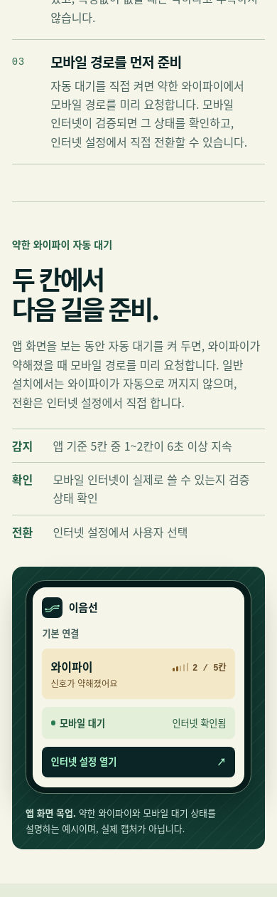

# 이음선 · IEUMSEON

약한 와이파이에 붙어 인터넷이 멎는 순간, **다음 경로를 먼저 확인하는** Kotlin Android 앱입니다. 루트, VPN, 위치, SSID 수집, 계정, 원격 측정 서버를 쓰지 않습니다.

[소개 및 상황 체험](https://ieumseon.pages.dev/) · [설치 테스트용 APK](https://github.com/hslcrb/ieumseon/releases/tag/v0.2.0-alpha.1) · [개발기](docs/DEVLOG.md) · [실기기 검증표](docs/DEVICE-CHECKS.md)

## 화면

*소개 사이트의 화면 목업입니다. 실제 무선 연결 측정 화면이 아닙니다.*

## 무엇을 하는가

| 동작 | 일반 Android | 기업 등 관리형 기기 |
| --- | --- | --- |
| 5칸 Wi‑Fi 신호와 인터넷 확인·로그인 필요 여부 표시 | 지원 | 지원 |
| 약한 신호 1–2칸이 6초 지속되면 모바일 경로 요청 | 사용자 동의 후, 앱 화면이 보일 때 | 동일 |
| Wi‑Fi 끄고 기본 경로가 셀룰러인지 확인 | 앱에서 인터넷 설정을 열고 **사용자가 전환** | 앱이 이미 **기기 소유자(Device Owner)**로 지정된 기기에서만, 별도 확인 및 조건 충족 후 한 번 시도 |
| 다른 앱에서 이미 열린 일반 TCP·통화·다운로드를 보존 | 미지원 | 미지원 |

이음선의 신호 게이지는 Android의 RSSI 신호 수준을 5칸으로 환산합니다. 제조사 상태바 아이콘과 항상 같은 수는 아닙니다. 신호 값이 가려지면 추정하지 않습니다. 3칸 이상 회복, 신호 정보 상실, 또는 다른 Wi‑Fi로 바뀌면 연속 6초 판단을 다시 시작합니다.

관리형 모드에서도 모바일 데이터가 사용 가능하고 차단되지 않은 상태가 일정 시간 확인될 때만 Wi‑Fi 끄기를 요청합니다. 완료 여부는 버튼을 누른 결과가 아니라 Android가 보고하는 실제 기본 경로로 확인합니다. 안드로이드가 작업을 거절할 수 있습니다. 설정에서 일반 앱 권한을 승인한다고 기기 소유자가 되는 것은 아니며, 이 앱은 관리 기기 등록을 대신하지 않습니다.

## 권한

| Android 권한 | 사용하는 이유 |
| --- | --- |
| `ACCESS_NETWORK_STATE` | 기본 연결과 Wi‑Fi·셀룰러 후보, 인터넷 검증·로그인 포털·차단 여부 관찰 |
| `CHANGE_NETWORK_STATE` | 사용자가 켠 모바일 대기 기능에서 잠시 셀룰러 네트워크 요청·해제. 기본 연결 강제 변경 권한은 아님 |
| `ACCESS_WIFI_STATE` | Wi‑Fi 신호의 단계 수 환산과 현재 라디오 상태 확인 |
| `CHANGE_WIFI_STATE` | 이미 기기 소유자로 설정된 경우에만 Wi‑Fi 끄기·되돌리기 요청. 일반 설치에 시스템 전환 능력을 부여하지 않음 |

기기 소유자 지정은 일반 권한이나 앱 안의 토글이 아니라 별도의 Android 기기 관리 상태입니다. 관리 리시버는 시스템의 `BIND_DEVICE_ADMIN`으로 보호되며 별도 정책(잠금·삭제·암호 제어)을 요청하지 않습니다. 개인 휴대전화를 이 기능만을 위해 관리형으로 전환할 필요는 없습니다. [공식 Android Wi‑Fi API](https://developer.android.com/reference/android/net/wifi/WifiManager#setWifiEnabled(boolean))의 예외 조건을 따릅니다.

## 설치와 소스

프리릴리즈의 APK는 **Android 10 이상 설치 테스트용 디버그 빌드**입니다. 실제 통신사의 연결 전환을 검증한 배포판은 아닙니다.

- `app/`: Kotlin Android 앱, 판단 로직과 JUnit 테스트
- `site/`: Vite 정적 소개 페이지
- `docs/`: 개발기·실기기 검증표·화면 자료
- 빌드: JDK 17 이상과 Android SDK 35를 준비하고 `./gradlew testDebugUnitTest assembleDebug`를 실행합니다. Windows는 `gradlew.bat testDebugUnitTest assembleDebug`를 사용합니다.

Cloudflare Pages 운영 브랜치는 `main`, 루트는 `site`, 빌드는 `npm run build`, 출력은 `dist`입니다. GitHub Actions는 사용하지 않습니다.
